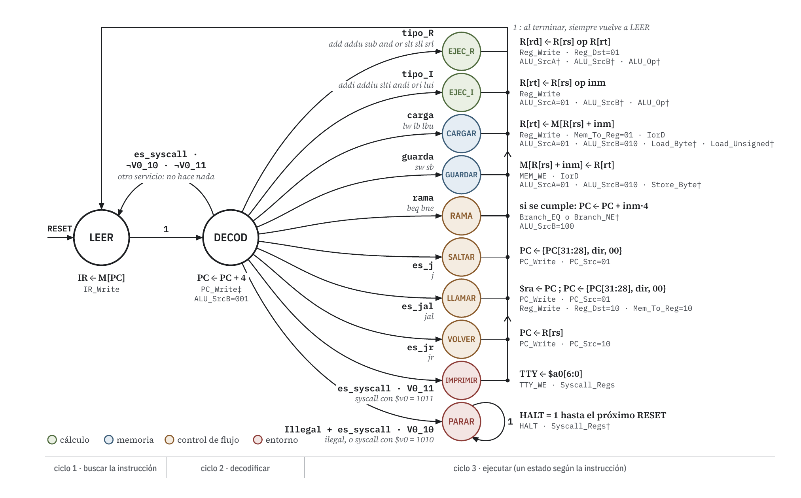
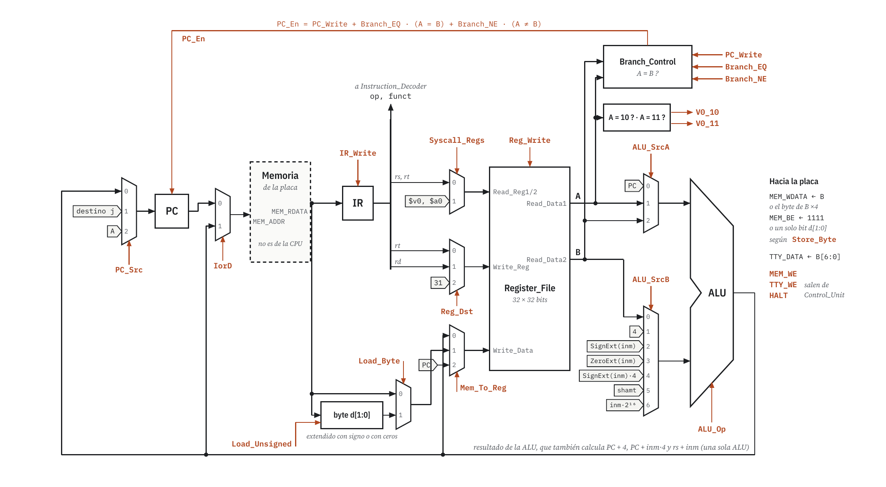

<div align="center">

# CPU S-MIPS multiciclo

**Un procesador MIPS de 32 bits construido puerta a puerta en Logisim Evolution.**<br>
Ruta de datos, unidad de control, ALU y banco de registros dibujados como circuitos, sin VHDL.<br>
Ejecuta programas ensamblados con MARS y produce exactamente su misma salida.

<br>



<sub>La unidad de control: doce estados, uno activo por ciclo, y lo que hace cada uno.</sub>

<br><br>

| 25 instrucciones | 3 ciclos por instrucción | 12 estados *one-hot* | 1 ALU · 1 sumador | 11 / 11 programas idénticos a MARS |
|:---:|:---:|:---:|:---:|:---:|

</div>

## Diseño

| | |
|---|---|
| **Tres ciclos, sin registros intermedios** | La memoria y el banco se leen de forma combinacional y el IR conserva la instrucción, así que sobran A, B, ALUOut y MDR. Toda instrucción se busca, se decodifica y se ejecuta. |
| **Una sola ALU** | Calcula PC + 4, los destinos de salto y las direcciones de memoria en ciclos distintos. La igualdad de `beq`/`bne` la resuelve un comparador aparte. |
| **Control *one-hot*** | Un biestable por estado: cada próximo estado es un AND de dos señales y cada señal de control, una OR de estados. |
| **Decodificador exhaustivo** | Una salida por instrucción y detección de ilegales, comprobadas sobre las 4 096 combinaciones de `op` y `funct`. |
| **Acceso por bytes** | `lb`, `lbu` y `sb` extraen, extienden y colocan el byte en su carril dentro de la propia ruta de datos. |

<details>
<summary><b>Ver la ruta de datos completa</b></summary>
<br>

</details>

## Probarlo

```bash
python3 tools/run_tests.py    # corre programs/ y tests/ en la CPU y compara el terminal con MARS
bash open.sh                  # abre el circuito en Logisim Evolution 5.0.0
```

Requiere Java 21, [Logisim Evolution 5.0.0](https://github.com/logisim-evolution/logisim-evolution) (`LOGISIM_JAR`) y MARS 4.5 (`MARS_JAR`).

## Contenido

```text
circuit/smips.circ    la CPU: Datapath, Control_Unit, ALU, Register_File, Instruction_Decoder, Branch_Control
tests/                programas propios en ensamblador S-MIPS
informe.pdf           el diseño completo: diagramas, tablas de control, ciclos y verificación
salida-tests.txt      resultado de la batería de pruebas
```

La placa (memoria, terminal, reloj), las herramientas de `tools/` y los programas de `programs/` forman parte del enunciado; el contenido de la CPU, las pruebas de `tests/` y el informe son trabajo propio.

<br>

<div align="center"><sub>Leonardo Albert López · Arquitectura de Computadoras · Facultad de Matemática y Computación, Universidad de La Habana · 2026</sub></div>
